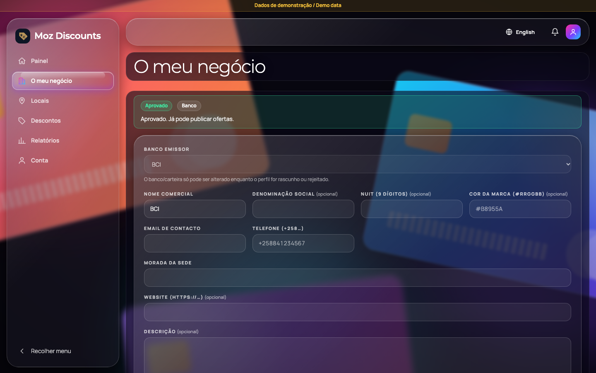
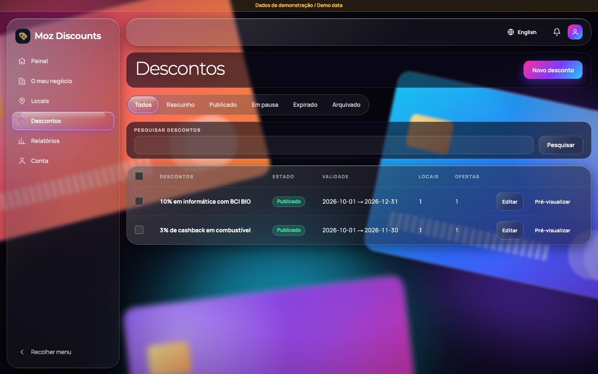
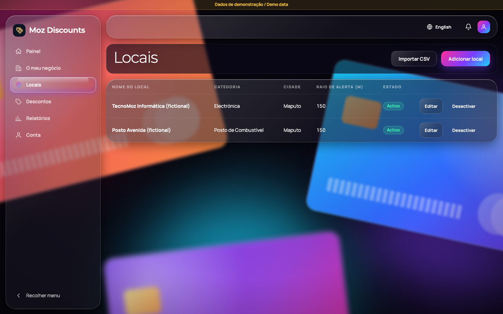

# Moz Discounts

Find discounts on your bank cards and mobile wallets in Mozambique, and get an alert when you walk past a place that offers one.

This repository is a **proof of concept (POC)** with three parts:

| Part | What it does |
|---|---|
| **Web portal** (`apps/web`) | Business owners (banks, wallet providers, merchants) manage their profile, premises and discounts. Admins approve businesses, manage the catalogue and users, read the audit trail and export it to Excel. A public map shows who offers what, no sign-in needed. |
| **REST API** (`apps/web/app/api/v1`) | Everything the portal and the app use, plus the public discovery endpoints (map, nearby, recent offers, geofence sync). |
| **iOS app** (`apps/ios`) | Customers pick their cards and wallets, browse a map with filters, favourite offers and receive proximity alerts. |

All sample data is fictional and marked "Dados de demonstração / Demo data".

**Live demo:** https://discount-app-rho.vercel.app (Vercel, with its own Neon database; sign-in needs an account the owner has shared with you). The home page is a scroll-driven marketing site that leads into the web application (`/login`, `/register`, `/map`); its source is `apps/web/components/landing.tsx`, with the original static version in `docs/site`.

## Screenshots

| Home | Sign in |
|---|---|
|  |  |
|  |  |



## Tech stack

- **Web and API:** Next.js 16 (App Router, route handlers), React 19, TypeScript
- **Database:** PostgreSQL on Neon, Prisma 7
- **Business rules:** `packages/core`, plain TypeScript with no framework imports (matching, active-offer rules, alert log, stats, exports)
- **iOS:** SwiftUI, MapKit, CoreLocation, local notifications, Face ID; the logic lives in a Swift package (`apps/ios/MozCore`) that passes the same test vectors as the TypeScript code
- **Design:** dark glassmorphism ([`docs/DESIGN-GLASSMORPHISM.md`](docs/DESIGN-GLASSMORPHISM.md)), Montserrat and Manrope, Portuguese first with English
- **Tests:** Vitest, Playwright with axe accessibility checks, XCTest and XCUITest

## Repository layout

```
apps/web         Next.js app: portal, public map, /api/v1
apps/ios         SwiftUI app, MozCore Swift package, UI tests
packages/core    Business rules (framework-free)
packages/db      Prisma schema and migrations
packages/shared  Design tokens, PT/EN strings, test vectors
packages/seed    Demo data (seed:demo)
docs/            Spec, decisions log, phase plans and reports, runbook, UAT checklist
```

## Quick start (web and API)

You need Node 22+, corepack, and a Neon Postgres database (a free project is enough).

```bash
corepack pnpm install
cp .env.example .env            # then fill in the values (see below)
corepack pnpm --filter @moz/db migrate:dev
corepack pnpm --filter @moz/seed seed:demo
corepack pnpm dev               # http://localhost:3000
```

Minimum `.env` values: `DATABASE_URL`, `DIRECT_URL`, `JWT_SECRET`, `MFA_ENC_KEY`, `SEED_DEMO_PASSWORD`. Everything else is optional:

- `SKIP_EMAIL_VERIFICATION=1` auto-verifies new accounts so you can test without email (ignored outside local and test environments).
- `RESEND_API_KEY` sends real emails; without it emails are printed in the server log.
- `NEXT_PUBLIC_GOOGLE_MAPS_KEY` shows the Google map (restrict the key by HTTP referrer, for example `http://localhost:3000/*`). Without it the map page shows the list of places only.
- To test from a phone on the same Wi-Fi, open `http://<your Mac's IP>:3000`. Private LAN ranges are allowed by default; add others with `DEV_ALLOWED_ORIGINS`.

Never commit `.env`. It is git-ignored.

### Accounts

Create your own: register on `/register` (business accounts need admin approval), or seed demo data with `seed:demo` if you want sample accounts. The iOS app is for customers only; business and admin accounts use the web portal.

## iOS app

Needs Xcode with the iOS 17 SDK or newer (built and tested with Xcode 27.1).

```bash
cd apps/ios
python3 tools/make_xcodeproj.py        # regenerates MozDiscounts.xcodeproj
open MozDiscounts.xcodeproj            # choose your Team, run on a simulator or phone
swift test --package-path MozCore      # logic tests
```

The app talks to the live site (https://discount-app-rho.vercel.app) by default, so it works on a phone without your Mac running. To test against a local server, set `MOZ_API_BASE_URL` in the target's build settings (or the scheme environment) to `http://<your Mac's IP>:3000`. Local proximity alerts work without a paid Apple account; push notifications need the Apple Developer Program.

UI tests (need the API running and the demo password):

```bash
TEST_RUNNER_MOZ_API_BASE_URL=http://localhost:3000 TEST_RUNNER_MOZ_DEMO_PASSWORD=... \
xcodebuild test -project MozDiscounts.xcodeproj -scheme MozDiscounts \
  -destination 'platform=iOS Simulator,name=iPhone 17' CODE_SIGNING_ALLOWED=NO
```

## Tests and checks

```bash
corepack pnpm typecheck
corepack pnpm lint
corepack pnpm test                     # shared, core and web (use a separate Neon branch: set TEST_DATABASE_URL)
corepack pnpm --filter @moz/web e2e    # builds, starts the app on :3100, runs Playwright and axe
```

Set `TEST_DATABASE_URL` and `TEST_DIRECT_URL` to a separate Neon branch, then run `pnpm --filter @moz/db migrate:test` and `pnpm --filter @moz/seed seed:demo:test`. Tests never touch your development data when those are set.

## What is in the box

- Business profiles with admin approval; premises with a Google Maps picker and CSV import; discounts with per-card and per-wallet benefits, schedules, a six-step wizard, preview, bulk actions and an audited lifecycle
- Public map with bank, wallet, card-type and category filters and marker clustering
- Customer cards, wallets, alert preferences and favourites; favourite-update pushes; an alert log with Excel export; admin and business statistics and reports
- Security basics: argon2 password hashing, lockout and rate limits, two-factor for admins, nonce-based CSP, append-only audit trail, tenant isolation, formula-injection-safe exports

## Documentation

- [`docs/SPEC.md`](docs/SPEC.md): the requirements this was built from
- [`docs/decisions-log.md`](docs/decisions-log.md): every choice the spec left open
- [`docs/plans/`](docs/plans): plan and report for each phase, plus [`overnight-report.md`](docs/plans/overnight-report.md)
- [`docs/runbook.md`](docs/runbook.md): run locally, deploy steps, security checklist
- [`docs/uat-checklist.md`](docs/uat-checklist.md): scenarios and how each is verified
- [`docs/traceability.md`](docs/traceability.md): requirement to test mapping

## Status and known gaps

Working and tested: the web portal, the API, the public map and the iOS app on the simulator.

Not yet done or not verified:

- Real-device checks (background alerts while walking, Face ID, the permission prompts) and Apple push delivery
- Registration email and captcha on the live site (need Resend and Turnstile keys); the deployment is manual (`vercel deploy --prod`), not yet connected to Git
- Real email delivery (needs a Resend key and a verified domain)
- Profile photo and logo uploads, the email-verification universal link, load and penetration testing

This is a demonstration. A legal review under Mozambican data-protection law is needed before any real launch (see [`docs/privacy-notice.md`](docs/privacy-notice.md)).
